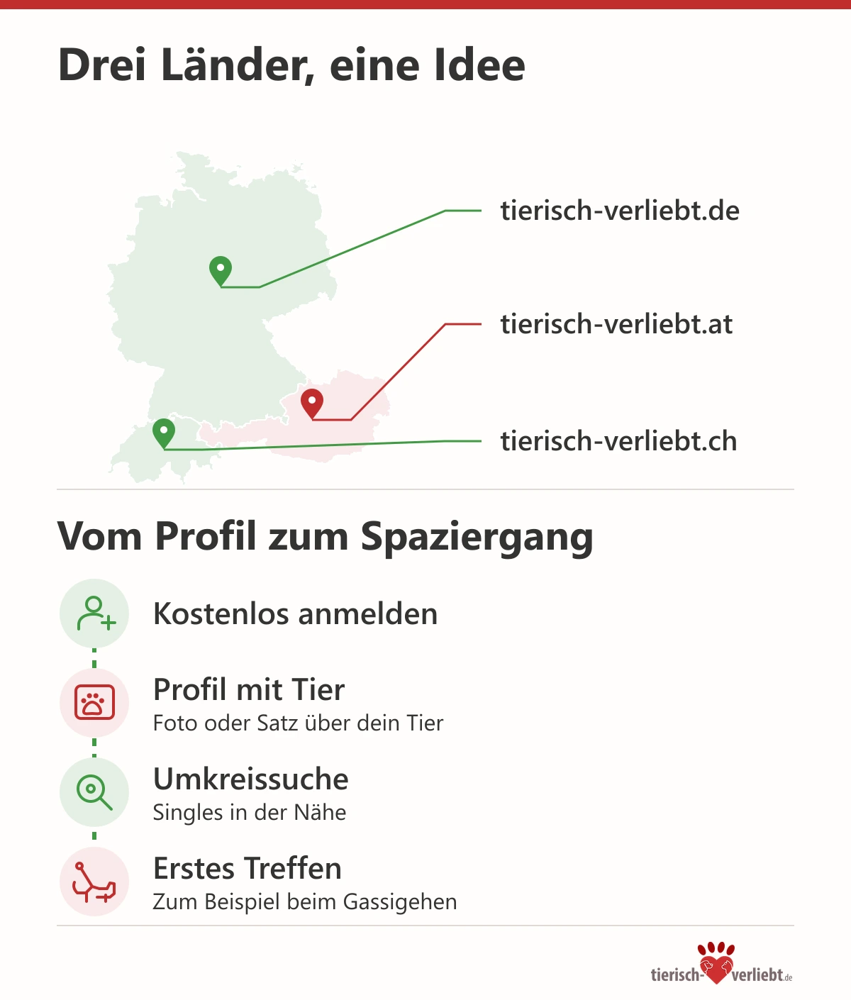

# Tierisch verliebt: Eine Singlebörse für Menschen, bei denen das Tier zur Familie gehört

Der Hund liegt schon an der Tür, bevor du überhaupt die Jacke anhast. Die Katze hat entschieden, dass dein Kopfkissen ab sofort ihres ist. Und am Wochenende richtet sich der Tag nach dem Stall, nicht nach dem Brunch-Termin. Wer mit Tieren lebt, kennt das: Sie gehören zum Alltag, und sie gehören zur Familie. Genau an diesem Punkt wird die Partnersuche oft schwierig. Denn wer neu in dein Leben kommt, trifft nicht nur dich, sondern auch die Fellnase auf dem Sofa.

## Warum Tierliebe bei der Partnersuche so viel zählt

Viele Tierhalter haben es schon erlebt. Das erste Treffen läuft gut, das Gespräch ist angenehm, und dann fällt ein Satz wie „Hunde im Bett gehen für mich gar nicht“ oder „Muss der Hund wirklich mit?“. Solche Momente sind kein Drama, aber sie zeigen früh, ob zwei Lebensentwürfe zusammenpassen. Ein Tier bestimmt mit, wie Abende, Urlaube und Wochenenden aussehen. Es kostet Zeit, manchmal Nerven und gelegentlich auch Geld beim Tierarzt.

Datingexperte Christian M. Haas erlebt seit vielen Jahren, dass gemeinsame Werte für eine Beziehung oft wichtiger sind als gemeinsame Hobbys. Tierliebe ist dafür ein gutes Beispiel. Wer sich um ein Tier kümmert, übernimmt Verantwortung, plant voraus und nimmt Rücksicht. Wer das bei einem anderen Menschen wiedererkennt, hat schon vor dem ersten Date eine Gemeinsamkeit, über die man nicht lange reden muss.

## Was hinter tierisch-verliebt steckt

Die Idee einer Singlebörse für Tierfreunde ist nicht neu. Der Name „Tierisch verliebt“ wurde nach Angaben der Betreiber bereits um 2008 für ein Datingangebot unter Tierfreunden genutzt. Dieses frühe Angebot wurde später eingestellt, der Name blieb. Christian M. Haas hat die Marke übernommen und [tierisch-verliebt.de](https://tierisch-verliebt.de/) im Jahr 2018 zusammen mit dem Plattformbetreiber Icony GmbH neu gestartet, mit moderner Technik, Datenschutz und klaren Abläufen.

Die Grundidee ist einfach: Hier treffen sich Singles, für die Tiere ein selbstverständlicher Teil des Lebens sind. Das können Menschen mit Hund, Katze, Pferd oder Kaninchen sein. Es können aber genauso Menschen sein, die sich ein Tier wünschen oder einfach gern mit Tieren zu tun haben. Ein eigenes Haustier ist keine Voraussetzung. Entscheidend ist, dass niemand erklären muss, warum der Hund beim Sonntagsspaziergang dabei ist.

## So läuft das Kennenlernen ab

Die Anmeldung ist kostenlos. Im Profil kannst du beschreiben, wer du bist, was du suchst und welche Rolle Tiere in deinem Leben spielen. Gerade dieser Teil macht den Unterschied zu allgemeinen Datingportalen. Ein Foto mit dem eigenen Hund oder ein Satz über die Katze, die beim Frühstück mitredet, ist hier kein Nebenthema, sondern ein guter Gesprächseinstieg.

Über die Umkreissuche findest du Singles in deiner Nähe. Das ist für Tierhalter besonders praktisch, denn ein erstes Treffen beim gemeinsamen Gassigehen ist oft entspannter als ein Abend im Restaurant. Der Hund nimmt Druck aus der Situation, ihr habt sofort ein Gesprächsthema, und beide sehen ganz nebenbei, wie der andere mit Tieren umgeht. Bei Katzen- oder Pferdemenschen ist es eher der Austausch über Alltag und Zeitplanung, der früh zeigt, ob es passt.

Ein paar Fragen helfen beim Schreiben, ohne dass es nach Vorstellungsgespräch klingt:

- Welches Tier lebt bei dir, und wie sieht euer typischer Tag aus?
- Wie verbringst du Urlaub, wenn das Tier mit muss oder versorgt werden soll?
- Gab es ein Tier, das dich besonders geprägt hat?

Solche Fragen öffnen ein Gespräch, ohne dass jemand sofort Bedingungen aufstellen muss. Die Antworten zeigen trotzdem schnell, ob eure Vorstellungen zusammenpassen.

## Auch in Österreich und der Schweiz

Tierliebe hört nicht an der Landesgrenze auf. Deshalb gibt es die Singlebörse nicht nur in Deutschland, sondern auch mit eigenen Seiten für Österreich und die Schweiz. Wer in Wien, Graz oder Salzburg sucht, findet Kontakte über [tierisch-verliebt.at](https://tierisch-verliebt.at/). In Zürich, Bern, Basel und den übrigen Schweizer Regionen ist [tierisch-verliebt.ch](https://tierisch-verliebt.ch/) der passende Einstieg. Die Länderseiten haben eigene Städteseiten mit regionalen Hinweisen, etwa zu Hundewiesen, Leinenpflicht oder Ausflugszielen mit Tier.

Gerade in Grenzregionen kann das interessant sein. Wer am Bodensee, im Allgäu oder in Salzburg wohnt, hat manchmal mehr Gemeinsamkeiten mit Menschen auf der anderen Seite der Grenze als mit Singles in der nächsten Großstadt.

## Mehr als eine Kontaktbörse

Neben der Partnersuche hat tierisch-verliebt ein umfangreiches Magazin aufgebaut. Dort geht es um Hunde- und Katzenrassen mit ihren Eigenheiten, um Alltagsfragen der Tierhaltung und um Themen rund ums Kennenlernen mit Tier. Die Artikel eignen sich auch, um sich vor einem Date über die Rasse des Gegenübers zu informieren oder um zu klären, ob ein Hund und eine Katze in einem gemeinsamen Haushalt gut zusammenleben könnten.

Das passt zur Haltung hinter der Seite. Eine Beziehung mit Tier ist nicht nur Romantik, sondern auch Organisation. Wer einzieht, wer den Tierarzttermin übernimmt, ob der neue Partner eine Allergie hat und wie zwei Tiere aneinander gewöhnt werden: Das sind Fragen, die früher oder später auf jedes tierliebe Paar zukommen. Es hilft, wenn man sie mit jemandem bespricht, der sie ernst nimmt.

## Für wen sich ein Blick lohnt

Eine Singlebörse für Tierfreunde ersetzt kein Bauchgefühl, und auch hier entscheidet am Ende die Begegnung. Sie sorgt aber dafür, dass eine wichtige Frage schon vor dem ersten Treffen geklärt ist. Wenn dein Tier ein fester Teil deines Lebens ist und du dir jemanden wünschst, der das von Anfang an versteht, ist [tierisch-verliebt.de](https://tierisch-verliebt.de/) einen Versuch wert. Und vielleicht ist der schönste Moment beim ersten Date dann der, in dem dein Hund sich einfach neben die neue Bekanntschaft legt.

<aside aria-label="Über den Gründer">
<h2>Über den Gründer</h2>

<strong>Christian M. Haas</strong> ist Datingexperte und Gründer mehrerer Nischen-Singlebörsen. 2018 hat er den Neustart von tierisch-verliebt ins Leben gerufen. Bis dahin war es ein weiter Weg: Die Wunschdomain tierisch-verliebt.de war längst vergeben, und den Namen kannten viele bereits aus dem Fernsehen, unter anderem durch die Sat.1-Romanze „Tierisch verliebt!“ aus dem Jahr 2013. Erst nach langen Gesprächen mit der damaligen Inhaberin konnte er die Domain übernehmen. Seitdem baut er die Plattform für Tierfreunde in Deutschland, Österreich und der Schweiz weiter aus.

</aside>
