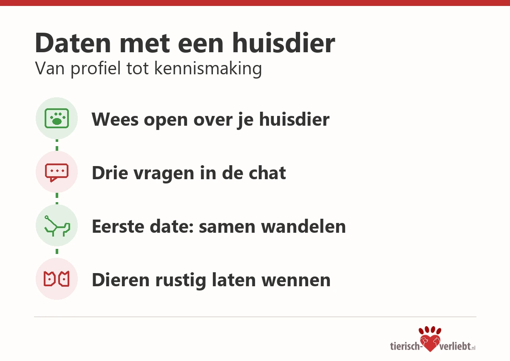

# Daten met een huisdier: zo merk je snel of het klikt, met jou én met je dier

Je hebt een leuke match, het gesprek loopt vanzelf en jullie spreken af voor een eerste date. Dan komt de vraag die elke dierenliefhebber kent: vertel ik meteen over mijn hond, of wacht ik nog even? Voor wie met een huisdier leeft, is dat geen bijzaak. Je dier bepaalt mee hoe je avonden, weekenden en vakanties eruitzien. Wie bij jou hoort, krijgt er dus automatisch een viervoeter, kat of paard bij.

## Waarom je huisdier geen geheim hoeft te zijn

Veel mensen houden hun huisdier in het begin een beetje op de achtergrond. Ze willen niet te veel eisen stellen of de ander afschrikken. Toch werkt openheid meestal beter. Een foto met je hond in je profiel of een zin over de kat die elke ochtend om zes uur ontbijt wil, zegt veel over hoe je leeft. Wie daar enthousiast op reageert, deelt waarschijnlijk iets belangrijks met je. Wie er meteen bezwaren bij heeft, past misschien minder goed bij je.

Datingexpert Christian M. Haas ziet al jaren dat gedeelde waarden voor een relatie vaak belangrijker zijn dan gedeelde hobby's. Dierenliefde is daar een goed voorbeeld van. Wie voor een dier zorgt, neemt verantwoordelijkheid, plant vooruit en houdt rekening met een ander. Als je dat bij iemand herkent, heb je al vóór de eerste date een stevige gemeenschappelijke basis.

## Drie vragen die je al in de chat kunt stellen

Je hoeft geen vragenlijst af te werken, maar een paar luchtige vragen geven snel een beeld. Ze openen het gesprek zonder dat het als een sollicitatie voelt:

- Heb je zelf dieren, of ben je ermee opgegroeid?
- Hoe ziet jouw ideale zondag eruit, en mag de hond daarbij zijn?
- Hoe denk je over dieren in huis, op de bank of in de slaapkamer?

Let vooral op de toon van het antwoord. Iemand die nooit een huisdier had, kan net zo nieuwsgierig en warm reageren als een ervaren hondenbezitter. Het gaat er niet om dat de ander alles al weet, maar dat jullie dezelfde richting op willen.

## De eerste date: samen wandelen werkt vaak het best

Een eerste ontmoeting in een restaurant kan stijf aanvoelen. Een wandeling met de hond is vaak ontspannener. Jullie hebben meteen iets om over te praten, er valt minder snel een ongemakkelijke stilte en je ziet vanzelf hoe de ander met dieren omgaat. Kies wel een rustige route waar honden welkom zijn en houd je hond aangelijnd als je niet zeker weet hoe hij op een vreemde reageert.

Heb je een kat of een paard, dan neem je je dier natuurlijk niet mee naar de eerste date. Vertel er gewoon over. Hoe je dag eruitziet met voertijden, stalwerk of dierenartsbezoeken, laat de ander al vroeg zien wat een relatie met jou in de praktijk betekent. Zo komt niemand later voor verrassingen te staan.

## Als het klikt: dieren aan elkaar laten wennen

Hebben jullie allebei een huisdier, dan komt er op een gegeven moment een spannend moment: de eerste kennismaking tussen de dieren. Neem daar de tijd voor. Twee honden ontmoeten elkaar het liefst eerst op neutraal terrein, bijvoorbeeld tijdens een gezamenlijke wandeling. Bij katten is geduld nog belangrijker. Een aparte ruimte, geuren uitwisselen en pas daarna voorzichtig kennismaken voorkomt veel stress. Bespreek ook praktische vragen op tijd, zoals allergieën, oppas tijdens vakanties en wie wanneer uitlaat.

## Een datingplek speciaal voor dierenliefhebbers

Wie niet steeds hoeft uit te leggen waarom de hond mee op vakantie gaat, heeft het makkelijker. Daarom zijn er datingplatforms die zich speciaal op dierenliefhebbers richten. In Duitsland, Oostenrijk en Zwitserland bestaat tierisch-verliebt al jaren als datingsite voor singles met een hart voor dieren. Met [tierisch-verliebt.nl](https://tierisch-verliebt.nl/) wordt nu ook een Nederlandse versie opgebouwd, met datingtips voor dierenliefhebbers in vijftien Nederlandse steden en informatie over populaire honden- en kattenrassen. Het platform is nog in opbouw. Aanmelden kan voorlopig via de Duitstalige versie.

Of je nu een hond, kat, paard of konijn hebt, of gewoon van dieren houdt: het helpt als je vanaf het begin eerlijk bent over de rol die dieren in je leven spelen. De juiste persoon vindt dat geen nadeel, maar juist een reden om nieuwsgierig te worden. En misschien is het mooiste moment van je eerste date wel het moment waarop je hond zich gewoon naast je nieuwe kennis neervlijt.

<aside aria-label="Over de auteur">
<h2>Over de auteur</h2>

<strong>Christian M. Haas</strong> is datingexpert en oprichter van verschillende nichedatingsites, waaronder tierisch-verliebt voor dierenliefhebbers in Duitsland, Oostenrijk en Zwitserland. Hij schrijft over hoe mensen met gedeelde waarden elkaar leren kennen.

</aside>
